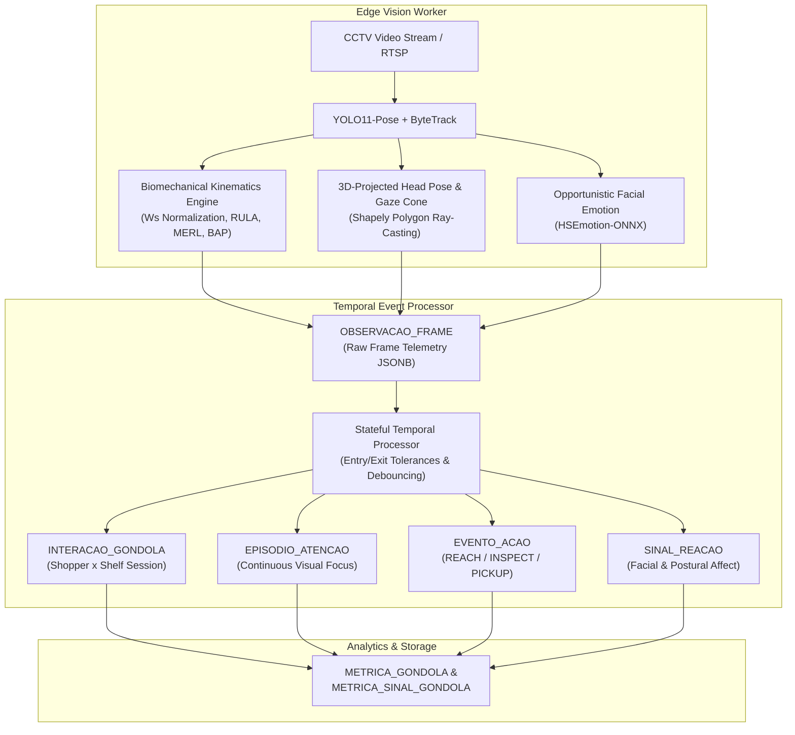
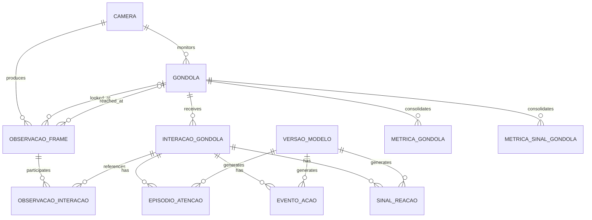

# Biomechanical and Multimodal Shopper Behavior Analytics

A computer vision and spatio-temporal analytics pipeline designed to measure shopper behavior, visual attention, physical product interactions, and affective reactions in brick-and-mortar retail environments using standard overhead CCTV cameras.

> **Project Status — Proof of Concept (PoC) and Methodological Validation:**  
> This repository currently hosts the experimental validation notebook (`.ipynb`). It demonstrates how to extract behavioral and biomechanical telemetry using established pre-trained foundation models (`YOLO11-pose` and `HSEmotion`) coupled with peer-reviewed kinematic equations. This approach eliminates the need for computationally expensive 3D depth reconstruction or large-scale custom dataset labeling during the initial validation phase.  
> **Next Steps:** Transitioning this validated core engine into a distributed, real-time production system featuring asynchronous message brokers, stream ingestion workers, relational time-series persistence, and an analytics dashboard.

---

## Core Business and Analytical Questions

This project is structured to answer four fundamental retail intelligence questions directly from surveillance video streams:

1. **Which gondolas and shelf zones receive the highest visual attention?**  
   Quantifying unique shopper impressions, continuous visual focus duration (in milliseconds), and traffic-to-attention conversion rates per shelf polygon.
2. **Which physical actions are triggered by each gondola?**  
   Distinguishing between shoppers who merely walk past a display, stop to analyze, reach out to touch or pick up a product, or engage in two-handed product inspection.
3. **Which affective states and sentiments are evoked per gondola?**  
   Mapping facial expressions (`smile`, `surprise`, `neutral`, `frown`) and postural affect indicators (such as cognitive hesitation, doubt, or active engagement) to specific store sections.
4. **Future Scope — Planogram, Pricing, and SKU Placement Optimization:**  
   Evaluating whether the physical placement of a specific item, its shelf height, or its pricing signage is in the optimal format. By correlating high visual attention and prolonged inspection or doubt (`INSPECTING / HESITATION`) with low product pickup rates, the system identifies friction points caused by pricing, packaging, or poor shelf positioning.

---

## Technical Capabilities Validated in the Notebook

1. **Multi-Object Pose Tracking (`YOLO11-pose` + `ByteTrack`):** Extracts 17 anatomical COCO keypoints per individual while maintaining persistent tracking IDs across frames.
2. **3D-Projected Head Orientation and Gaze Cone (2D Ray-Casting):** Estimates 3D head rotation ($\text{Yaw}, \text{Pitch}, \text{Roll}$) and projects a 2D Field-of-View (FOV) cone onto shelf polygons (`Shapely`), operating reliably even when shoppers have their backs turned to the camera.
3. **Scale-Invariant Biomechanical Action Engine:** Uses the projected **Biacromial Width ($W_s$)** (shoulder width) as an intrinsic anatomical reference to compute camera-distance-invariant metrics grounded in occupational ergonomics (**RULA**), retail action primitives (**MERL**), and affective body coding (**BAP**):
   * **Shelf Reach and Product Pickup:** Coupled elbow extension ($\theta_{\text{elbow}} > 130^\circ$), shoulder elevation ($\theta_{\text{shoulder}} > 38^\circ$), and normalized reach ratio ($R_{\text{reach}} > 1.10 \cdot W_s$).
   * **Product Inspection:** Bimanual convergence ($I_{\text{bimanual}} < 0.85 \cdot W_s$) and acute elbow flexion ($\theta_{\text{elbow}} \in [50^\circ, 115^\circ]$) while stationary.
   * **Cognitive Hesitation and Doubt:** Hand-to-head/chin self-adaptors ($I_{\text{head-adaptor}} < 0.72 \cdot W_s$) and horizontal head yaw oscillation ($\sigma_{\text{yaw}} > 13.5^\circ$).
4. **Opportunistic Facial Expression Recognition (`HSEmotion-ONNX`):** Crops and classifies facial emotions whenever facial keypoints are visible with sufficient confidence.
5. **Action-Segregated Spatial Heatmaps:** Projects Gaussian kernel density heatmaps onto the clean `Frame(0)` reference image, segregated by specific biomechanical actions and affective states.
6. **Stateful Temporal Event Processor:** Consolidates frame-by-frame observations into structured relational database payloads (`JSONB`) aligned with the target production schema.

---

## Processing Pipeline and Temporal Aggregation Flow

---

## Target Production Database Schema (ERD)

The Temporal Processor outputs data structured for our target **PostgreSQL / TimescaleDB** relational schema:

---

## Scientific References

1. **Dael, N., Mortillaro, M., & Scherer, K. R.** (2012). *The Body Action and Posture Coding System (BAP): Development and reliability*. Journal of Nonverbal Behavior, 36(2), 97-121.
2. **Frontoni, E., Raspa, P., Mancini, A., Zingaretti, P., & Placidi, V.** (2014). *Customers' activity recognition in intelligent retail environments*. In International Conference on Image Analysis and Processing (pp. 509-516). Springer.
3. **Karg, M., Samadani, A. A., Gorbet, R., Kühnlenz, K., Hoey, J., & Kulić, D.** (2013). *Body movements for affective expression: A survey of automatic recognition and generation*. IEEE Transactions on Affective Computing, 4(4), 341-359.
4. **Kleinsmith, A., & Bianchi-Berthouze, N.** (2013). *Affective body expression perception and recognition: A survey*. IEEE Transactions on Affective Computing, 4(1), 15-33.

