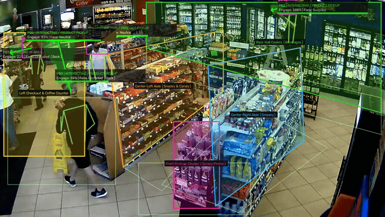
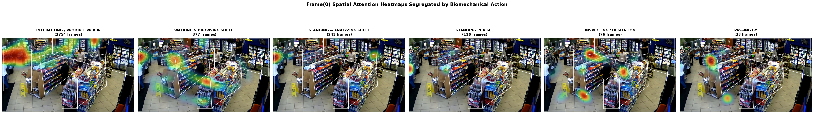
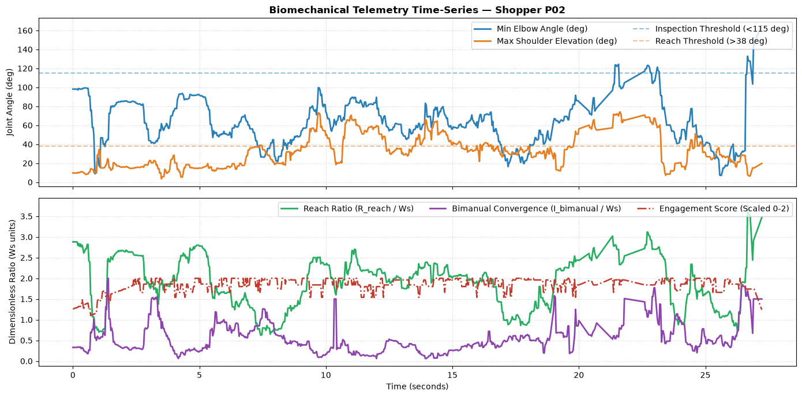
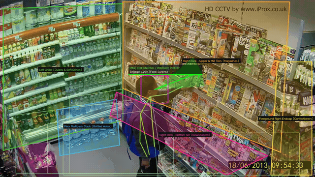
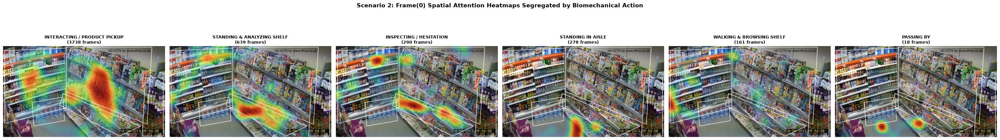
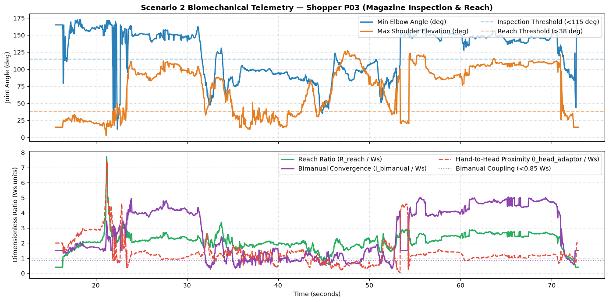
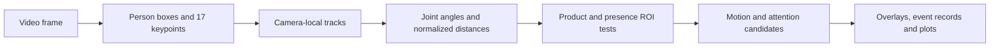
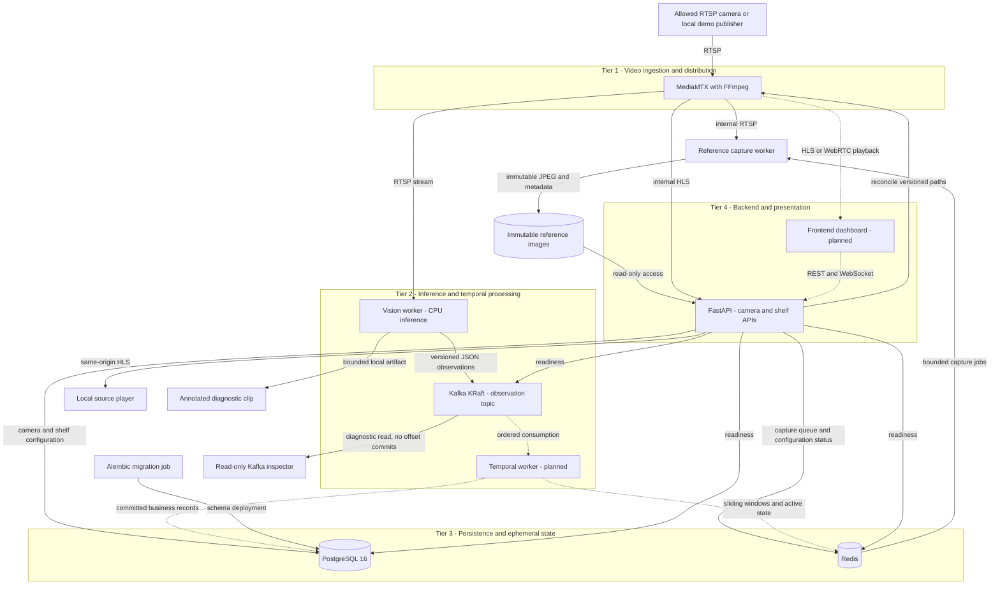
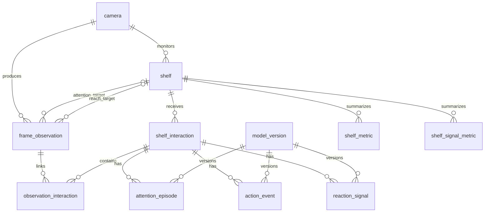

# Biomechanical and Multimodal Shopper Behavior Analytics

[](https://www.python.org/)
[](https://www.postgresql.org/)
[](LICENSE)

A computer vision platform for studying shopper attention, physical interactions,
and facial or postural reactions around retail displays. The planned pipeline
combines camera-local pose tracking, biomechanical indicators, temporal events,
and per-display analytics.

The infrastructure, persistence layer, operational APIs and CPU vision worker are
implemented. The worker reads RTSP through MediaMTX, runs YOLO11-pose/ByteTrack,
extracts qualified geometric features and publishes observations to Kafka. A local
demonstration produces an annotated clip, structured logs and delivery evidence.
Temporal business processing, analytics and the dashboard remain under development.
The scientific rules are experimental: head direction is an attention proxy, and
reaching does not establish touch, product removal or purchase.

[Demonstrations](#processed-video-demonstrations) ·
[Scientific method](#scientific-method-from-pose-to-movement-indicators) ·
[Infrastructure](#infrastructure-architecture) · [Quick start](#quick-start) ·
[Run the vision worker](#run-and-review-the-vision-worker) ·
[Database](#database-and-contracts) · [Next steps](#next-steps)

## Processed Video Demonstrations

The [Jupyter notebook](notebooks/shopper_behavior.ipynb) produced the annotated
exports below. The animated previews play directly in the README; select a preview
or its MP4 link to open the complete processed export. Both exports use H.264 at
1280 × 720 and retain the original frame timing.

### Retail Store Overview

[](docs/media/retail-store-processed.mp4)

[Open processed video — 31.7 seconds](docs/media/retail-store-processed.mp4)
· [Original source](https://www.youtube.com/watch?v=-1bRhYjw1qE)

Five configured shelf and presence zones cover the aisles, cooler wall, promotional
display and checkout area. The export illustrates person tracks, pose skeletons,
head-direction projections and the notebook's action/expression overlays across
950 processed frames. It is a bounded excerpt of the source footage.

**POC results — spatial distribution and biomechanical telemetry**

[](docs/media/retail-store-heatmaps.png)

The heatmaps project head-direction estimates onto the first video frame, grouped
by the notebook's action labels and weighted by its heuristic engagement score.
Each panel scales its intensity independently; colors show relative concentrations
within that panel. Frame counts include repeated observations of the same tracks.

[](docs/media/retail-store-kinematics.png)

The time series follows the track with the most recorded observations. It shows
estimated elbow/shoulder angles, reach and inter-hand distance normalized by
projected shoulder width, and the notebook's engagement score. Dashed thresholds
are classification rules used by the POC, not validated behavioral measurements.

### Aisle Close-Up

[](docs/media/aisle-closeup-processed.mp4)

[Open processed video — 212.5 seconds](docs/media/aisle-closeup-processed.mp4)
· [Original source](https://www.youtube.com/watch?v=B9xQM8GEiYk)

The closer camera view shows the beverage chiller, magazine/newspaper racks and
nearby displays. The export illustrates tracking, ROI alignment and upper-limb
indicators under a different camera perspective, across 6,374 processed frames.
The six-second preview is an excerpt; the MP4 contains the full available export.

**POC results — a second camera perspective**

[](docs/media/aisle-closeup-heatmaps.png)

These panels show where estimated head-direction projections accumulate around
the chiller and magazine racks. They use the same per-panel normalization as the
first example and cannot establish an absolute attention comparison across cameras.

[](docs/media/aisle-closeup-kinematics.png)

The selected track's time series adds hand-to-head proximity alongside joint
angles, normalized reach and bimanual convergence. Its time span covers that
track's observations within the longer video. Occlusion, camera perspective and
pose estimation errors can affect these curves. Select any figure for full size.

These are experimental visualizations, not annotated ground truth or accuracy
benchmarks. Burned-in labels such as `PRODUCT PICKUP`, facial expressions and
engagement percentages are legacy notebook estimates; they do not establish object
removal, verified emotion or purchase. The backend's stricter contracts require
separate product evidence and explicit unknown/quality semantics. The notebook
currently keeps its event tables in memory rather than writing to PostgreSQL.

Third-party footage retains its original rights; the repository's MIT license
applies to project code.

## Scientific Method: From Pose to Movement Indicators

The [notebook](notebooks/shopper_behavior.ipynb) combines pretrained pose estimates
with explicit geometric and temporal rules. It does not train a shopper-action
classifier on the demonstration videos. The equations below describe the POC;
the numerical thresholds are project heuristics that still require calibration
and validation on labeled footage.



### Pose Estimation and Tracking

`yolo11s-pose.pt` estimates a person bounding box and 17 COCO-format landmarks,
including shoulders, elbows, wrists, hips and ankles. Each landmark has image
coordinates and a confidence score. The notebook processes frames through
Ultralytics tracking with `persist=True`, allowing measurements to be grouped by
a camera-local track. See the [Ultralytics pose documentation](https://docs.ultralytics.com/tasks/pose/)
for the keypoint layout.

ByteTrack is the selected tracking approach for the planned vision worker.

### Shoulder-Width Normalization

For frame `t`, let `P5` and `P6` be the left and right shoulder coordinates in the
original image plane. Their projected separation defines the scale:

$$
W_s(t) = \left\|P_6(t) - P_5(t)\right\|_2
$$

For shoulder `S`, wrist `W` and estimated head origin `H`, the notebook computes:

$$
R_{\mathrm{reach}} = \frac{\|W-S\|_2}{W_s},\qquad
I_{\mathrm{bimanual}} = \frac{\|W_R-W_L\|_2}{W_s},\qquad
I_{\mathrm{head}} = \frac{\min_{W\in\{W_L,W_R\}}\|W-H\|_2}{W_s}
$$

These dimensionless ratios reduce sensitivity to image scale. They do not recover
physical distance or guarantee invariance to perspective, body rotation or partial
occlusion. Calculations use pixel coordinates; normalized storage coordinates must
be converted with the correct image width and height before Euclidean geometry.
The POC includes bounding-box scale fallbacks and a minimum shoulder-width clamp;
the production worker must mark unusable scale as unavailable instead of treating
these substitutions as anatomical measurements.

### Joint Angles and Motion

For three landmarks `A`, `B`, `C`, the angle at `B` is:

$$
\theta(A,B,C) = \frac{180}{\pi}\arccos\left(
\min\left(1,\max\left(-1,
\frac{(A-B)\cdot(C-B)}{\|A-B\|_2\|C-B\|_2}
\right)\right)\right)
$$

The elbow angle uses `(shoulder, elbow, wrist)`. The shoulder angle uses
`(hip, shoulder, elbow)`, comparing the shoulder-to-hip torso direction with the
upper arm. Both are **2D projected angles**, not recovered anatomical 3D rotations.
The POC uses the minimum or maximum available arm measurements according to each
rule; the planned worker must evaluate reach conditions on the same arm and
resolve invalid-point handling explicitly.

Movement uses the ankle midpoint, with a bounding-box bottom-center fallback,
and a buffer of up to 15 observations. For `n` buffered positions, the notebook's
normalized motion estimate is:

$$
v_{\mathrm{norm}}(t) =
\frac{\|q_t-q_{\mathrm{oldest}}\|_2}{n\,W_s(t)}
$$

It is an approximate displacement per processed frame, not meters per second.
The standing threshold `0.048` therefore depends on sampling cadence. A 15-frame
buffer also spans different durations at different frame rates. Production
extraction must define event-time sampling, buffer warmup and missing-data rules.

### Behavioral Candidate Rules

The following conditions summarize the current notebook logic. They describe
observable posture candidates and the POC's display categories.

| Indicator | Current POC condition | Interpretation |
|---|---|---|
| Stationary posture | `v_norm < 0.048` | Low image-plane motion at the current sampling rate |
| Reach posture | Maximum reach ratio `> 1.10`, maximum elbow angle `> 130°`, maximum shoulder angle `> 38°` | Arm-extension candidate; the POC combines maxima across arms |
| Bimanual inspection candidate | Stationary, `I_bimanual < 0.85`, minimum elbow angle between `50°` and `115°` | Hands close together with flexed arms; object identity remains unverified |
| Hesitation candidate | Stationary and either hand-to-head ratio `< 0.72` with minimum elbow angle `< 108°`, or yaw standard deviation `> 13.5°` with an associated shelf target | A postural/head-motion pattern, not a measured cognitive state |
| Stationary shelf attention | Stationary, projected shelf target present, accumulated focus counter at least `300 ms` | Head-direction association used as an attention proxy |

Reach/ROI candidates take precedence over inspection/hesitation and attention
categories in the overlay. A wrist entering a product polygon can trigger the
legacy `PRODUCT PICKUP` label even without product evidence. The backend instead
requires separately supported object displacement for `PICKUP` and `RETURN`.

### Head Direction, Shelf Association and Expressions

When facial landmarks are usable, the notebook estimates direction from the ear
midpoint toward the facial-landmark centroid, blended with torso orientation.
For a back-turned shopper, it uses ear-confidence asymmetry and cervical offset
relative to the shoulders. Direction is smoothed with an exponential moving
average (`alpha = 0.35`). The displayed cone has an 18° half-angle and a projected
length of `2.5 × Ws`; these are visualization settings, not a calibrated visual
field. Shelf association uses a Shapely line/polygon intersection and selects the
nearest intersected product polygon.

Although the notebook names some methods “3D”, this fallback is a heuristic
projection from 2D landmarks, without camera calibration, depth recovery or eye
tracking. Head direction cannot establish what a shopper actually sees. Product
and floor-presence polygons provide separate spatial contexts, which the backend
preserves through independent observation links and versioned geometry snapshots.

[HSEmotion](https://github.com/av-savchenko/hsemotion) supplies facial-expression
estimates when a usable face crop is available. The POC combines mapped expression
valence, action weights, focus duration and posture into a bounded `0–100`
engagement index. That index is not a calibrated probability, emotional diagnosis,
or purchase score. The notebook retains some default-angle and neutral-expression
fallbacks; worker extraction must replace unsupported measurements and labels with
explicit unknown values and quality metadata.

### Temporal Results, Heatmaps and Scientific Background

The notebook groups observations into experimental in-memory interactions, events
and metrics. Its frame-derived timing and focus counters need replacement by the
reviewed event-time lifecycle before business use. The planned temporal processor
will apply entry/exit tolerances, supported-interval duration accounting, independent
presence/attention/reach links, and immutable rule/model versions.

The published heatmaps accumulate projected head-direction endpoints on `Frame(0)`,
weighted by the POC engagement index, then apply Gaussian smoothing (`sigma = 36`
pixels) and per-panel normalization. They show relative observation density. The
plots are not an eye-tracking fixation map, a count of unique shoppers, or directly
comparable absolute attention across camera views.

The methodological background includes
[RULA, McAtamney and Corlett (1993)](https://pubmed.ncbi.nlm.nih.gov/15676903/) for
upper-limb posture assessment,
[MERL Shopping, Singh et al. (2016)](https://www.merl.com/research/highlights/merl-shopping-dataset)
for fine-grained retail action categories, and
[the Body Action and Posture coding system, Dael et al. (2012)](https://link.springer.com/article/10.1007/s10919-012-0130-0)
for structured descriptions of body movement. This POC uses related concepts;
it does not implement the full RULA assessment or BAP coding procedure, reproduce
the MERL detector, or establish that these sources validate its numerical rules.
The demonstration videos above are separate from the MERL dataset.

## Infrastructure Architecture

The target system has four tiers. Docker Compose delivers the service foundation,
persistence, configuration APIs, reference capture and an optional CPU vision worker.
The notebook runs separately; it does not feed
the broker, run the production workers or populate the application database.



Solid arrows represent implemented operational and deployment paths. Dashed arrows
represent planned operational data paths. PostgreSQL, Redis, Kafka and MediaMTX
are running infrastructure services; dashed links do not imply their business
integrations are delivered. The frontend has a reserved workspace, with no selected
framework, build image or Compose service yet.

### Component Responsibilities and Delivery Status

| Component | Implemented foundation | Planned operational responsibility |
|---|---|---|
| MediaMTX + FFmpeg | Internal RTSP proxy, reconciled paths, HLS playback and optional local publisher | Validate camera/site codecs and transport at deployment |
| Reference capture | Separate FFmpeg worker, bounded Redis jobs, immutable JPEG/metadata in a named volume | Apply deployment-specific reference retention and backup policy |
| Vision worker | Bounded capture/reconnect, pinned CPU pose/tracker/face adapters, qualified features, Kafka publication and annotated diagnostics | Complete human-labeled scientific evaluation; add independently supported product evidence if approved |
| Kafka KRaft | Broker/topic, active camera-keyed vision producer, read-only inspector and manual-acknowledgement helpers | Buffer lightweight observations and preserve partition order for temporal processing and retained-history recovery |
| Temporal worker | Separate workspace and infrastructure preflight | Confirm interactions, segment attention/action/reaction episodes, commit results and project metrics |
| Redis | Password-protected ephemeral service, reference queue, API rate limits and expiring configuration acknowledgements | Hold reconstructible track windows and active state; cache analytical responses |
| PostgreSQL 16 | Eleven domain tables, validated JSONB, repositories, constraints, indexes and migrations | Remain the durable source for observations, business records, model/geometry provenance and analytical projections |
| FastAPI backend | Camera/shelf CRUD, optimistic revisions, Frame(0), runtime configuration and health | Add analytics and WebSocket updates |
| Frontend | Reserved `frontend/` workspace | Present live playback, a versioned ROI editor, shelf rankings, heatmaps, action/reaction timelines and funnels |

### Why Kafka, Redis and PostgreSQL Have Separate Roles

**Kafka transports observations.** The default topic is `retail.frame-observations`
with three partitions in the local topology. Producer helpers use `camera_id` as
the record key and send bounded JSON rather than video or face crops. Ordering is
within a partition. The consumer helper acknowledges the next offset only after
its persistence callback returns; the future processor must commit its transaction
before that return, coordinate rebalances and handle redelivery. These helpers do
not establish application-level exactly-once processing.

**Redis holds disposable state and cache.** Planned temporal state includes recent
keypoints, confirmation buffers and active episode context scoped by
camera/session/track/shelf/ROI version. Cache entries use a separate namespace and
a validated TTL of 60–300 seconds. State expiration is not an interaction closure
and must not be the sole record of a business result. Recovery after state loss
must use verified retained history; that processor is still planned.

**PostgreSQL owns durable results and provenance.** Observations, typed links,
interactions, episodes, actions, reactions and aggregate rows live alongside
immutable model configurations and historical geometry snapshots. A future unit
of work must write related records atomically before Kafka acknowledgement.
Analytics will read PostgreSQL through the backend, consulting Redis for cached
responses; browser clients will not connect directly to the database or broker.

### Compose Topology and Startup

The Compose services are `postgres`, `redis`, `kafka`, `kafka-init`, `mediamtx`,
`migrate`, `api` and `reference-capture`. The optional `demo` profile adds
`demo-source`, which loops an original local video over authenticated RTSP.
The `vision` profile adds the real `vision-worker` and read-only
`observation-inspector`. The `verification` profile provides `tests`,
`vision-preflight` and `temporal-worker`; the latter still performs infrastructure
preflight only. The vision image has a separate CPU dependency lock and FFmpeg;
model packages are excluded from the API image. The notebook remains independent.

PostgreSQL readiness gates Alembic migration. Successful migration, Redis health,
Kafka topic initialization and MediaMTX health gate API startup. PostgreSQL,
Kafka and reference images use named volumes; Redis has no persistence. Internal services
stay on the Docker bridge, and only the API is published on host loopback. This
single-node development setup does not deliver production high availability or
public playback access.

## Requirements

- Docker Engine with Docker Compose.
- Python 3 for local configuration generation.
- Python 3.12 only when developing the backend outside Docker.

## Quick Start

From the repository root:

```bash
# First setup only; refuses to overwrite an existing .env file.
python3 scripts/configure_local.py

docker compose config --quiet
docker compose up -d --build --wait api
docker compose ps -a
curl --fail http://127.0.0.1:8000/health/ready
```

For an existing installation, use `python3 scripts/configure_local.py --upgrade`
before rebuilding. It appends missing settings without replacing existing secrets.

Configuration generation creates independent database, Redis and media passwords
without displaying them. Keep `.env` private. The `migrate` service applies
`alembic upgrade head`; the API and verification services wait for it to succeed.
A successful one-shot migration container exits with code 0.

Readiness returns `{"status":"ready"}` when PostgreSQL is at revision
`0002_english_names`, Redis responds, and the observation topic is available. Liveness
is available at `/health/live`. Dependency failures return HTTP 503 from readiness.

Only the API is published, on `127.0.0.1:8000`. To use another local port, run
`API_PORT=8080 docker compose up -d --build --wait api`. PostgreSQL, Redis, Kafka,
and media protocols have no published host ports. The single-node broker and local
bridge are a development topology; production access, transport and capacity
require a deployment-specific configuration.

## Operational API and Visual Verification

| Routes | Behavior |
|---|---|
| `GET/POST /api/v1/cameras`, `GET/PUT /api/v1/cameras/{id}` | Camera management; responses omit stream URLs and credentials |
| `GET/POST /api/v1/shelves`, `GET/PUT /api/v1/shelves/{id}` | Versioned product/presence polygons; stale updates return 409 |
| `GET /api/v1/cameras/{id}/frame-zero` | Stable JPEG with dimensions, capture time and reference/source revision headers |
| `POST /api/v1/cameras/{id}/frame-zero` | Explicit refresh after deactivating shelves and closing active interactions |
| `GET /api/v1/cameras/{id}/runtime` | Safe desired worker configuration and proxy application status |
| `GET /api/v1/cameras/{id}/playback`, `GET /api/v1/cameras/{id}/player` | HLS descriptor and local source-video player |
| `GET /api/v1/cameras/{id}/hls/{asset}` | Bounded same-origin HLS playlists/segments; upstream credentials stay internal |

## Run and Review the Vision Worker

Use the original local iProx input, `notebooks/iprox_retail_aisle_hd.mp4`, with its
five notebook ROI definitions and English shelf categories. The default camera is
`IPROX_HD_RETAIL_AISLE_01`; `infrastructure/demo_scenario.json` binds its input,
proxy path and shelf fixture together. The repository keeps source footage and model
weights outside Git. The commands below reuse the same APIs and database geometry
as the operational demonstration.

```bash
# Existing installation: append new settings without rotating service passwords.
python3 scripts/configure_local.py --upgrade

# Copy and verify existing YOLO/HSEmotion artifacts into ignored models/.
python3 scripts/prepare_vision_models.py

# Build the CPU worker, start services, configure the demo and verify the pipeline.
python3 scripts/demo_stage4.py --build --max-frames 600 --max-seconds 120
```

If the weights are absent locally, the preparation script accepts `--pose-source`
and `--face-source`. Its explicit `--download` option permits downloads from the
pinned official sources in `infrastructure/vision-models.json`; checksums must match.
The runtime never downloads models. The manifest selects the actual artifacts;
legacy notebook/foundation path settings do not select a different model silently.
The default iProx demo budget is 600 processed frames or 120 seconds so a short
empty opening does not end the run before shoppers enter the scene.
The reproducible CPU runtime uses Python 3.12, YOLO11s-pose, explicit ByteTrack and
HSEmotion ONNX. GPU execution is not part of this validated image.

The harness starts the diagnostic consumer before inference, verifies HLS and
requires actual model observations to reach Kafka. On Linux it uses `setfacl` to
give the image's non-root UID access to `outputs/stage4`; it does not make generated
output directories world-writable. No frontend build or application login is needed.

### What to Open

The command prints the annotated video, JSON execution report, source player and log paths.
No HTML report, SVG overlay or reference-image copy is generated by the demo scripts. Generated
artifacts are under `outputs/stage4/` and remain ignored by Git:

| Artifact | What it verifies |
|---|---|
| `run-*/annotated.mp4` | H.264 video with skeletons, track IDs, product/presence ROIs, candidate labels and per-frame timings |
| `run-*/report.json` | Model/configuration IDs, capture counters, published observations, partition offsets and timing percentiles |
| `run-*/observations.jsonl` | Bounded sample of validated observation envelopes, with complete geometry and model provenance |
| `producer-*.jsonl` | Worker lifecycle, source/tracking/configuration boundaries, sampled acknowledgements and periodic summaries |
| `consumer-*.jsonl` | Diagnostic receive events, topic/partition/offset and wall-clock observation age |
| `inspected-*.jsonl` and matching `.summary.json` | Observations actually read back from Kafka and consumer-group offset status |
| `verification.json` | Successful demo artifact paths, published count and local source-player URL |

Open the printed `annotated.mp4` in a video player and check that skeletons follow people,
product/presence polygons align with the scene, and IDs remain coherent while a
track is visible. Missing measurements show `UNKNOWN` or null; the worker does not
invent a neutral expression or a measurement from an occluded joint. The HLS player
shows the original source stream. The processed clip is a separate worker artifact,
with repeated samples holding the last frame to preserve elapsed capture timing.

The run directory contains `annotated.mp4`, `report.json` and
`observations.jsonl`. `latest.json` identifies the most recent run; `verification.json`
links its producer/consumer logs and inspected Kafka samples. The operational setup
writes only `outputs/stage3/verification.json`; the immutable reference image remains
in the application's reference-storage volume.

To inspect the most recent JSON report from the terminal:

```bash
python3 - <<'PYREPORT'
import json
from pathlib import Path
root = Path("outputs/stage4")
latest = json.loads((root / "latest.json").read_text())
run = root / latest["run_directory"]
print("Annotated video:", run / "annotated.mp4")
print((run / "report.json").read_text())
PYREPORT
```

### Read the Producer and Consumer Diagnostics

```bash
rg 'producer_acknowledged|vision_summary|vision_tracking_epoch' outputs/stage4/producer-*.jsonl
rg 'observation_received|inspection_summary' outputs/stage4/consumer-*.jsonl

# Read a bounded sample already in Kafka without changing business-group offsets.
docker compose --profile vision run --rm observation-inspector   python -m workers.vision_streamer.inspect --from-beginning --limit 10 --timeout 30
```

Match `observation_id`, `camera_id`, `tracking_session_id`, frame sequence and
partition/offset between the logs and JSON samples. Producer acknowledgements are
sampled to bound logging volume; counters include every acknowledged observation.
Kafka carries normalized evidence JSON, never video frames or face crops.

| Measurement | Meaning |
|---|---|
| `capture_to_inference_age` | Time in the worker between receiving a decoded frame and starting its inference |
| `inference` | Pose, optional face and feature-extraction work for the processed frame |
| `producer_ack` | Publication time including any bounded retries until Kafka acknowledgement |
| `capture_to_publish_ack` | Internal receive-to-acknowledgement delay; business persistence is not included |
| `sampling_skips` | Source frames intentionally omitted by the sampling policy |
| `overload_drops` | Sampled frames replaced in the single latest-frame slot while the worker is busy |
| `observed_age_ms` | Inspector receive time minus observation time, assuming synchronized wall clocks |
| `lag_offsets` | End offset minus committed next offset for the named business consumer group |

The inspector is a **read-only diagnostic consumer**. It does not create business
interactions, commit production offsets or fill analytical tables. Before Stage 5
starts committing offsets, group lag is `null` with `UNCOMMITTED`, rather than zero.
Local durations use monotonic clocks. Physical exposure-to-result latency remains
unavailable without a validated camera timestamp mapping. Reports explicitly state
that scientific acceptance is pending and pickup/return/touch are unsupported.

### Test Reconnects, Cutovers and Broker Failure

After a successful demo:

```bash
python3 scripts/verify_stage4_faults.py

docker compose --profile verification run --build --rm tests
```

These live fault checks are optional manual verification, separate from the unit
suite. The final code changes were verified with unit tests; the live fault
sequence must be reviewed by the person running it.

The fault script is restricted to the known five-shelf local demo. It temporarily
stops/restores the video publisher, checks a new source/tracking epoch, applies the
same polygons as a new ROI version and checks history/cutover isolation. It then
stops/restores Kafka and verifies bounded retries, a failed worker exit and readiness
recovery. It preserves polygon coordinates and records results under
`outputs/stage4/faults/`. It deliberately advances one demo shelf's ROI version;
this is a real configuration update, not a database reset.

A download-free source fixture is also available:

```bash
python3 scripts/create_rtsp_fixture.py
```

This creates a 15-second H.264 test pattern for transport tests. It contains no
people and cannot validate pose accuracy or the retail polygons. Set
`DEMO_VIDEO_FILE=./outputs/stage4-fixture.mp4` when intentionally testing that input,
then restore the iProx source before running the retail demonstration.

### Extraction and Scientific Acceptance

The worker evaluates reach on the **same arm**, uses the angle at the shoulder
between shoulder-to-hip and shoulder-to-elbow vectors, and suppresses invalid scale
instead of substituting bounding-box width. Motion is measured in projected
shoulder-widths/second using event-time intervals; stationary detection needs a
full valid 15-observation window. At the default 10 Hz sampling target, the POC's
`0.048` threshold becomes `0.48 Ws/s`. These are explicitly versioned engineering
conventions, not evidence that the thresholds are calibrated across cameras.

Head direction is a heuristic 2D projection, without recovered depth or eye tracking.
Facial classification requires a sufficiently visible, sharp face crop and records
only supported mapped expressions. No qualifying crop means an unavailable result.
The current evidence adapter explicitly disables contact, pickup and return;
wrist entry alone cannot assert those actions.

`infrastructure/vision-evaluation.json` defines disjoint review ranges and an
annotation protocol. Human labels, reviewer acceptance and accuracy targets remain
pending; no precision/recall result is fabricated from these demonstration runs.

## Database and Contracts

The database contains these eleven domain tables, plus Alembic's revision table:

- Assets: `camera`, `shelf`.
- Provenance: `model_version`.
- Observations and relationships: `frame_observation`, `observation_interaction`.
- Business records: `shelf_interaction`, `attention_episode`, `action_event`, `reaction_signal`.
- Analytical projections: `shelf_metric`, `shelf_signal_metric`.

Database tables and columns, Python domain types, JSON keys, diagrams, comments
and technical documentation use English. Constraints reject invalid
intervals, counts, confidences, link types and cross-camera targets. Model versions
are immutable; ROI updates preserve earlier snapshots and reject stale versions.
JSONB payloads are validated before ORM writes and indexed with GIN.



Observation uniqueness is scoped by camera, tracking session, local track and frame.
An observation can link to an interaction as `PRESENCE`, `ATTENTION` and `REACH`
independently. Metrics use composite shelf/granularity/window keys. Full geometry
snapshots and immutable model references support historical interpretation; ROI
edits preserve previous versions in JSONB instead of overwriting history.

Migration `0002_english_names` brings existing databases to the English naming
standard without recreating domain records. Observation contract 2.0 uses English
keys throughout. Coordinate existing writers/readers with migration deployment.
The validated schemas define envelope versioning, null semantics, model dependencies,
deterministic identifiers, geometry history and retention eligibility.

```bash
# Inspect the migration revision and detect metadata drift.
docker compose run --rm migrate alembic current
docker compose run --rm migrate alembic check

# Inspect application tables inside PostgreSQL.
docker compose exec postgres sh -c 'psql -U "$POSTGRES_USER" -d "$POSTGRES_DB" -c "\dt"'
```

## Tests and Code Quality

```bash
# Unit tests and real PostgreSQL, Redis and Kafka integration tests.
docker compose --profile verification run --build --rm tests

# Static checks using the same test image.
docker compose --profile verification run --rm tests ruff check .
docker compose --profile verification run --rm tests ruff format --check .
```

Persistence tests apply migrations to disposable, randomly named PostgreSQL schemas.
They verify upgrade/downgrade, schema compatibility, JSONB round trips, model
immutability, geometry concurrency, scoped references, and transaction rollback.
The application schema is not downgraded by the test suite.

Host tests skip service integration unless explicitly enabled. The root
`requirements.txt` and existing notebook environment are separate from the backend
lockfiles; scientific/model runtime compatibility is validated independently.

To run only unit tests locally, without opening any video or contacting the
Compose services:

```bash
cd backend
python3.12 -m venv .venv
.venv/bin/python -m pip install -r requirements-dev.lock
.venv/bin/python -m pytest -q
```

Service integration tests skip unless `RUN_INTEGRATION_TESTS=1`. Model adapters are
mocked in the unit suite; core tests skip optional NumPy/OpenCV cases when those
packages are absent. To include those unit cases, install the separate vision lock
in an isolated Python 3.12 environment. This still does not run source videos.

The GitHub Actions workflow runs source checks, notebook publication checks, unit
tests and Docker-backed integration tests on pushes and pull requests. It creates
ephemeral credentials for its local services and does not run model inference or
download source footage.


## Repository Layout

```text
backend/
  app/core/          Configuration, database, cache and broker clients
  app/domain/        Deterministic identity functions
  app/models/        Eleven SQLAlchemy domain models
  app/schemas/       Validated asset, observation and event contracts
  app/repositories/  Persistence, geometry versioning and history eligibility
  migrations/        Alembic environment and versioned migrations
  tests/             Unit and isolated service integration tests
  workers/           Reference capture, vision/temporal workspaces and preflight
frontend/            Reserved dashboard workspace
infrastructure/      MediaMTX configuration, demo publisher and reviewed ROI fixtures
docs/                Public technical documentation
  media/             Reviewed processed exports and animated previews
notebooks/           Experimental vision and biomechanical analysis
scripts/             Local setup utilities
docker-compose.yml   Local service orchestration
```

## Next Steps

The next implementation is **Stage 5: the temporal consumer and durable business
processing**. The vision producer and diagnostic inspection are implemented;
interaction/episode consolidation and analytics remain pending.

| Stage | Scope and current status | Completion evidence |
|---|---|---|
| Core APIs and planograms | Implemented: camera/shelf management, stable reference capture, geometry versions and proxy propagation | API integration tests, worker/control tests and reproducible RTSP/ROI visual demonstration |
| Video and vision workers | Implemented: CPU inference, bounded RTSP/reconnect, qualified features, versioned Kafka observations, HLS and annotated diagnostics | Real model/RTSP/Kafka execution and fault tests; human-labeled scientific acceptance remains pending |
| Temporal processing | Planned: interaction lifecycle, episodes, transaction-before-acknowledgement, deterministic redelivery handling and reconstruction | Entry/exit/loss boundary tests, supported-duration accounting, crash/rebalance fault tests and replay equivalence |
| Analytics and live delivery | Planned: cache-first shelf rankings, coverage-aware visitors/funnels/heatmaps, WebSocket and observability | Correct window/cohort denominators, cache isolation, freshness/coverage metadata and measured latency/lag |
| Frontend dashboard | Planned: framework selection, separate build/Compose service, playback, ROI editor and analytical views | Operator walkthroughs covering version conflicts, unavailable evidence, stale data and reconnects |

### Scientific Validation Priorities

Before interpreting the POC labels as business measurements:

1. Build a labeled evaluation set with separate presence, head-direction attention,
   reach, inspection and independently supported product-displacement events.
2. Calibrate camera geometry, shoulder-angle convention, confidence thresholds and
   sampling cadence; measure errors under occlusion, changing scale and track loss.
3. Report event precision/recall, boundary/duration error, track fragmentation and
   observable coverage per camera. Evaluate on held-out footage before setting
   deployment thresholds.
4. Remove fabricated/default evidence during worker extraction. Unsupported touch,
   pickup, return or facial inference must remain unavailable in APIs and dashboards.
5. Measure throughput, dropped samples, Kafka lag, recovery horizon, database growth
   and API latency using the agreed deployment hardware and camera workload.

No delivery dates, deployment capacity or scientific accuracy targets are claimed
until those measurements and acceptance decisions exist.

## Data and Operation Boundaries

Named volumes retain PostgreSQL and Kafka data across `docker compose down`.
Redis is ephemeral and must not be the sole source for business records. Automatic
raw-data deletion is not enabled: replay and unique-track operations require
verified retained-history coverage. Camera-local tracks do not identify people
across cameras or restarts. Face crops are not persisted. Bounded annotated diagnostic clips and observation
samples are explicit local review outputs and remain outside Git. Real-store ingestion and facial processing require a defined deployment
policy and access controls.

## License

[MIT](LICENSE).
